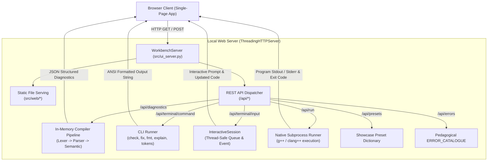

# 🖥️ Interactive C++ Compiler Workbench GUI (`GUI.md`)

Welcome to the **Interactive C++ Compiler Workbench**, a lightweight, responsive, 3-pane developer environment built directly into the compiler engine. It enables developers, students, and educators to edit C++ source code, inspect real-time compiler diagnostics, explore pedagogical error explanations, and execute interactive terminal commands—all within a modern web interface.

> [!IMPORTANT]
> **Strict Zero-Dependency Architecture:** The workbench requires **no external packages** (no Node.js, no npm, no pip dependencies). It runs 100% on the Python 3.10+ standard library (`http.server`, `threading`, `queue`, `urllib.parse`, `subprocess`).

---

## ⚡ 1. Quick Start

Launch the workbench with a single CLI command:

```bash
# Launch workbench with demo.cpp and automatically open in default browser (port 8080)
python main.py workbench demo.cpp

# Or use the compiler's CLI alias
c++ workbench demo.cpp

# Launch on custom port without automatically launching browser
python main.py workbench demo.cpp --port 9000 --no-browser
```

Once running, navigate to:
```text
http://127.0.0.1:8080
```
*(If port 8080 is in use, the server automatically scans and binds to the next available port up to 8100).*

---

## 📐 2. User Interface Architecture (3-Pane Layout)

The workbench is structured into three synchronized, responsive developer panes:

```text
+----------------------------------------------------------------------------------------------------+
|  [>] C++ Compiler Workbench    [Preset: Cross-Language v]  [Fix All]  [Format]  [Run]   (:8080)   |
+-------------------------------------------------+--------------------------------------------------+
|  PANE 1: SOURCE CODE EDITOR (main.cpp)          |  PANE 2: DIAGNOSTICS & ERROR INSPECTOR           |
|                                                 |                                                  |
|  1 | #include <iostream>                        |  [!] 2 Errors, 1 Warning                         |
|  2 |                                            |                                                  |
|  3 | def add(int a, int b) -> int:              |  --> Line 3, Col 1: Cross-Language Syntax (P005) |
|  4 |     return a + b;                          |      'def' is a Python function keyword          |
|  5 |                                            |      Help: Change to 'int add(int a, int b)'     |
|  6 | int main() {                               |                                                  |
|  7 |     int res = add(5, 10)                   |  --> Line 7, Col 25: Missing Semicolon (P003)    |
|  8 |     print("Result: %d", res);              |      Expected ';' at end of statement            |
|  9 |     return 0;                              |      [Explain P003]  [Quick Fix]                 |
| 10 | }                                          |                                                  |
+-------------------------------------------------+--------------------------------------------------+
|  PANE 3: INTERACTIVE TERMINAL CONSOLE (ANSI & CLI)                                                 |
|                                                                                                    |
|  c++ > fix -i                                                                                      |
|  [Patch 1/2] main.cpp:3:1 - Python Function Definition (P005)                                     |
|  - 3 | def add(int a, int b) -> int:                                                              |
|  + 3 | int add(int a, int b) {                                                                    |
|  Apply this patch? [y]es, [n]o, [e]xplain, [a]ll, [d]iff, [q]uit: _                               |
+----------------------------------------------------------------------------------------------------+
```

### Detailed Pane Breakdown

1. **Pane 1: Reactive Code Editor (`main.cpp`):**
   - Syntax-highlighted editing buffer with line numbering and tab/indentation management.
   - **Showcase Presets Dropdown:** Instantly loads pre-configured pedagogical test cases:
     - *Cross-Language Syntax:* Python `def`, `elif:`, `print`, `boolean`, `None` $\to$ C++.
     - *Missing Semicolons & Delimiters:* Missing statement/struct `;` and unclosed braces.
     - *Expression Repair:* Concatenated identifiers (`ab+`) and dangling operators.
     - *Auto-Include Headers:* Missing `<iostream>`, `<vector>`, `<cmath>` injection.
     - *Operator Misuse:* Accidental assignment in conditions (`if (x = 5)`), XOR vs power (`2 ^ 8`), and chained comparisons (`1 < x < 10`).
     - *Array Bounds:* Compile-time static bounds checking and off-by-one loop conditions.
     - *Clean Hello World:* Error-free baseline passing all compilation stages.

2. **Pane 2: Diagnostics & Pedagogical Error Inspector:**
   - Real-time diagnostic cards updated debounced as the user types.
   - Displays line, column, error code, explanatory summary, and Rustc-style source code snippets with caret underlines.
   - **Modal Error Catalogue Viewer:** Clicking `[Explain Code]` loads in-depth explanations, common causes, and good vs. bad code snippets directly from `src/error_catalogue.py`.

3. **Pane 3: Interactive Pseudo-Terminal Console:**
   - Emulates an interactive terminal supporting ANSI escape color codes.
   - Accepts all compiler subcommands: `run`, `check`, `fix`, `fix -i`, `suggest`, `explain [code]`, `fmt`, `tokens`, `clear`, `help`.
   - **Real-Time Keystroke Streaming:** In interactive mode (`fix -i`), keystrokes (`y`, `n`, `e`, `a`, `d`, `q`) are streamed directly to the background patch review thread.

---

## 🏗️ 3. Client-Server Architecture



---

## 🌐 4. REST API Endpoint Specification

All endpoints communicate using standard JSON payloads with CORS enabled:

| Method | Endpoint | Description | Request Body | Response Format |
|---|---|---|---|---|
| `GET` | `/` | Serves semantic HTML5 shell | *(none)* | `text/html; charset=utf-8` |
| `GET` | `/colors.css` | Theme tokens & color definitions | *(none)* | `text/css; charset=utf-8` |
| `GET` | `/workbench.css` | Responsive grid & component styles | *(none)* | `text/css; charset=utf-8` |
| `GET` | `/workbench.js` | Editor, ANSI renderer & API client | *(none)* | `application/javascript` |
| `GET` | `/api/presets` | Showcase preset snippets | *(none)* | `{"preset_id": {"title", "description", "code"}}` |
| `GET` | `/api/initial` | Initial source code passed via CLI | *(none)* | `{"code": string \| null}` |
| `GET` | `/api/errors?code=<code>` | Catalogue explanation entry | *(query param)* | `{"entry": {"title", "description", "causes", ...}}` |
| `POST` | `/api/diagnostics` | In-memory AST & semantic diagnostics | `{"code": string}` | `{"errors": [...], "warnings": [...]}` |
| `POST` | `/api/format` | AST pretty-printer | `{"code": string}` | `{"formatted_code": string}` |
| `POST` | `/api/terminal/command` | CLI command execution | `{"command": string, "code": string}` | `{"output": string, "is_interactive": bool, "prompt": string, "updated_code": string \| null}` |
| `POST` | `/api/terminal/input` | Deliver keystroke to active session | `{"input": string}` | `{"output": string, "is_interactive": bool, "prompt": string, "updated_code": string \| null}` |
| `POST` | `/api/run` | Compile & execute binary via host compiler | `{"code": string}` | `{"output": string, "exit_code": int}` |

---

## 📂 5. Web Assets Directory Map (`src/web/`)

The web assets are located in [`src/web/`](file:///c:/Users/Omkar%20Joshi/Desktop/COMPILER/Compiler-Design-PROJECT/src/web/):

* [`index.html`](file:///c:/Users/Omkar%20Joshi/Desktop/COMPILER/Compiler-Design-PROJECT/src/web/index.html): Semantic layout containing header toolbar, preset picker, editor pane, diagnostics pane, terminal pane, and modal dialogue.
* [`colors.css`](file:///c:/Users/Gourav/Desktop/Compiler-Design-PROJECT/src/web/colors.css): Centralized design tokens and professional monochrome studio color scheme (Obsidian `#0A0A0C`, pure stark white `#FFFFFF`, jet black `#000000`, and refined zinc accents).
* [`workbench.css`](file:///c:/Users/Omkar%20Joshi/Desktop/COMPILER/Compiler-Design-PROJECT/src/web/workbench.css): Grid layout rules, flex containers, diagnostic card badges, buttons, scrollbars, and terminal font styling.
* [`workbench.js`](file:///c:/Users/Omkar%20Joshi/Desktop/COMPILER/Compiler-Design-PROJECT/src/web/workbench.js): Client-side reactive logic, debounced diagnostics, ANSI-to-HTML parser, CLI command dispatcher, and interactive session keystroke listener.

---

## 🧪 6. Testing & Automated Verification

The entire workbench HTTP server, REST endpoints, and interactive session manager are rigorously tested in [`tests/test_workbench.py`](file:///c:/Users/Omkar%20Joshi/Desktop/COMPILER/Compiler-Design-PROJECT/tests/test_workbench.py):

```bash
# Run all workbench unit tests
python -m unittest tests/test_workbench.py

# Run all 235 tests across the compiler
python main.py test -v
```

### Verified Test Cases
1. `test_01_index_html`: Verifies root endpoint serves valid HTML.
2. `test_02_colors_css_centralization`: Confirms color tokens are centralized in `colors.css`.
3. `test_03_workbench_css` & `test_04_workbench_js`: Verifies MIME types and asset delivery.
4. `test_05_presets_api`: Validates all showcase presets load with non-empty code.
5. `test_06_error_catalogue_api`: Tests dynamic retrieval of error code documentation (`E002`, `P003`).
6. `test_07_format_api`: Verifies in-memory C++ source formatting.
7. `test_08_cors_options`: Verifies HTTP OPTIONS and CORS headers.
8. `test_09_check_with_syntax_errors`: Confirms syntax errors do not crash or terminate the HTTP server.
9. `test_10_format_with_syntax_errors`: Confirms format gracefully reports errors on broken code.
10. `test_11_api_run_endpoint`: Verifies compiler delegation and execution sandbox.
11. `TestCompilerExecutionEngine`: Verifies `check`, `fix`, `tokens`, `explain`, and diagnostics extraction.
